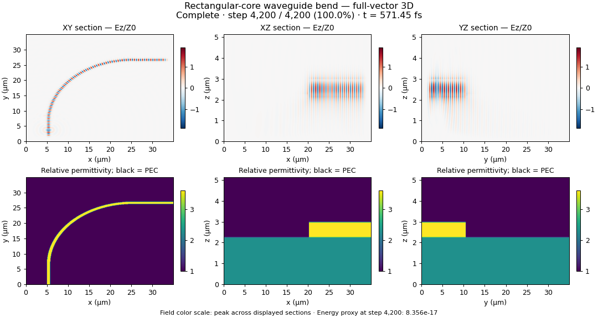

# PyLab Native

**Version 0.7.3 · Apple Silicon · macOS 26 or later**

A native scientific Python desktop workbench with a MATLAB-style layout and Jupyter notebook execution. SwiftUI and AppKit provide the interface; a separate IPython kernel runs the code. The app uses Apple's Liquid Glass APIs for navigation and controls, with readable native materials around code and data.

## What you can do

- Work in **multiple project tabs**, each with its own Python kernel, notebooks, console, and variables. Open several notebooks within a project and reorder project, notebook, and named cell tabs with magnetic drag-and-drop.
- Edit `.ipynb` notebooks with inline outputs, VS Code-inspired Python colors, line numbers, indentation guides, supported block folding, completions, search, and native Undo. Switch between **All Cells** and **Cell Tabs** without losing editor state.
- Run cells, selections, cells above/below, or a notebook; interrupt or restart Python; debug ordinary Python with temporary breakpoints. A running cell shows a spinner, elapsed time, amber border, `In [*]`, and Stop. Queued and waiting-for-input states are distinct, including on notebook and project tabs.
- Inspect a MATLAB-style **Workspace** table grouped by notebook/cell, edit paged NumPy arrays and pandas tables, inspect numeric statistics, import/export supported data, and create plots from variables.
- Choose **Shared Variables** for project-wide cell variables or **Independent Cells** for separate Python namespaces. The console follows the selected independent cell. A mode change restarts the kernel after confirmation.
- Watch **live figures** update in place while Python runs. Inline previews and an already-open figure share the latest frame instead of accumulating a frame history. Code keeps its allocated space.
- Dock the command console below Workspace, below the notebook, or across the bottom. Adjust panes, code/output split, themes, editor palette and font. Light, Dark, and System appearance respect macOS accessibility preferences.

## Start here

| Task | Guide |
| --- | --- |
| Install, select Python, and run your first notebook | [Quick start](docs/QUICK_START.md) |
| Learn cells, variables, figures, and shortcuts | [User guide](docs/USER_GUIDE.md) |
| Build the app, run checks, or contribute | [Development](docs/DEVELOPMENT.md) · [Contributing](CONTRIBUTING.md) |
| Understand kernels, storage, and live output | [Architecture](docs/ARCHITECTURE.md) |
| Build, sign, and package a macOS `.app` | [Packaging](docs/PACKAGING.md) |
| Diagnose kernel, import, and rendering issues | [Troubleshooting](docs/TROUBLESHOOTING.md) |
| Inspect release scope and evidence | [Changelog](CHANGELOG.md) · [Validation record](VALIDATION.md) |

## Install or build

Download the [v0.7.3 macOS arm64 development ZIP](https://github.com/larryTheran/pylab-native/releases/download/v0.7.3/PyLabNative-0.7.3-macos-arm64.zip) and verify it against `SHA256SUMS` on the [release page](https://github.com/larryTheran/pylab-native/releases/tag/v0.7.3), or build from source:

```sh
git clone https://github.com/larryTheran/pylab-native.git
cd pylab-native
./scripts/build.sh
open dist/PyLabNative.app
```

The build needs **Xcode with the macOS 26 SDK** and its command-line tools selected. The output is an arm64, locally signed development app. Signing and notarization for distribution are described in [Packaging](docs/PACKAGING.md).

Python is external to the app. The initial default is `/opt/miniconda3/bin/python3.12`; choose another executable through **Python Kernel** if that installation does not exist. Its environment needs `jupyter_client`, `ipykernel`, `numpy`, `pandas`, and `matplotlib`. Optional `scipy` supports MAT exchange, and `openpyxl` supports Excel. The app can check package metadata and copy an installation command, but never installs packages automatically.

## Live plotting and FDTD

PyLab supports standard IPython display handles:

```python
from IPython.display import display

view = display(fig, display_id=True)
# Inside your simulation loop, update the existing Matplotlib artists:
line.set_ydata(new_values)
view.update(fig)
```

Run [Live Plot Demo.ipynb](Examples/Live%20Plot%20Demo.ipynb) for a five-second example. Each `update()` replaces the same output; **Open Figure** and **Figures** continue refreshing. Save/reopen preserves the latest frame as a normal notebook output. Display links are session state and detach when Python restarts.

The companion [FDTD Python repository](https://github.com/larryTheran/fdtd-python) contains 1D, 2D, and 3D simulations. Its updated 3D runner automatically enables a six-panel live field/material preview in an IPython notebook. Import a 3D experiment into PyLab and run its existing `main(CONFIG)` in a fresh kernel. Preview displays XY/XZ/YZ field sections, step count, physical time and sampled energy; it is capped at four intermediate frames per second by default. The solver's final results are still written normally. See the companion project's 3D guide for `--live-fps`, `--live-stride`, `--no-live`, result folders, and scientific limits.



The preview above is rendered from an existing completed waveguide result to show the six-panel layout. During a new live run, the field sections and step/time labels evolve; the material sections remain fixed.

## Repository map

```text
Sources/       Native app, editor, workspace, kernel controller, and layout
Resources/     JSON-lines Jupyter bridge and Python workspace operations
Examples/      Small .ipynb workflows, variable-sharing and live-plot demos
scripts/       App build and focused test entry points
tests/         Swift model/native checks and Python/Jupyter regressions
docs/          Setup, user guide, architecture, development and packaging
.github/       Public-repository CI and issue templates
Info.plist     App identity, macOS requirement and version 0.7.3 (12)
Package.swift  Swift package for Xcode/source development
```

## Scope and limits

PyLab is a native notebook workbench, not a complete JupyterLab extension host. HTML/JavaScript widgets are not executed in the interface; unsupported MIME output is retained in notebook files. The editor implements syntax highlighting and supported indentation-based folding, not a language server or full IDE debugger. Shared variable attribution is best-effort rather than a complete provenance history. Independent Cells separates variable names within one kernel; it is not process or security isolation.

Notebook source, metadata, rich outputs, and the latest live image are saved. Unsaved edits and live Python memory are not restored after quitting or restarting. CPU/memory readouts measure the project's IPython process; they do not enforce resource limits or configure GPUs. Code has the file/network permissions of the user running the app. See [Security](SECURITY.md) and [Licensing](LICENSING.md).
